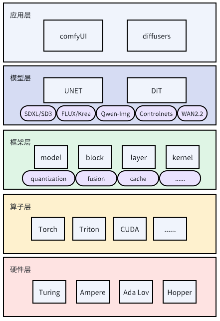
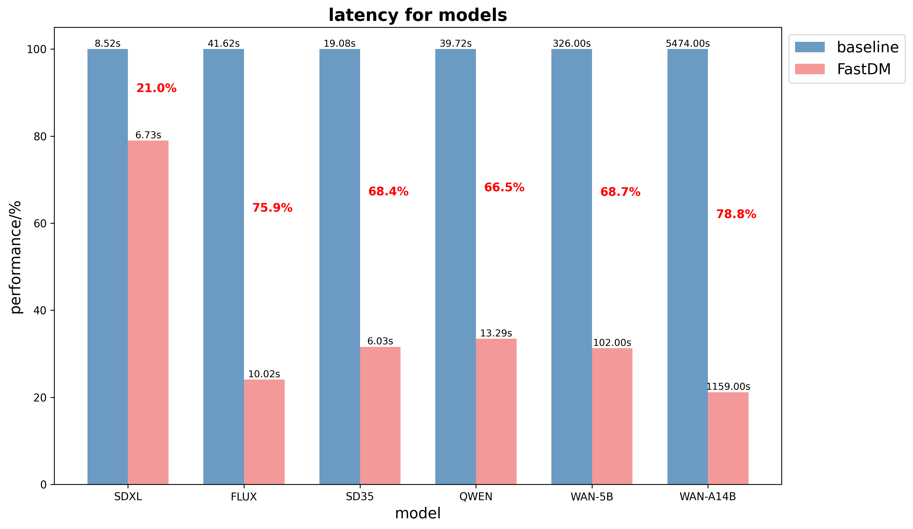
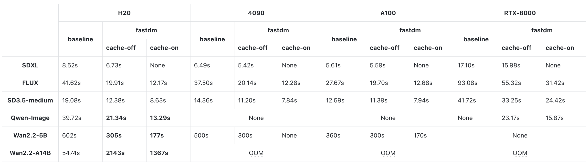

[English ReadME](README_en.md) | [中文 ReadME](README.md)

### 简介

Fast Diffusion Models(FASTDM): 是一个扩散模型推理工程，它支持主流文生图/视频模型结构，支持多种GPU架构算力卡，支持comfyui集成。

工程结构如下：

FastDM采用模型量化与Caching技术取得了较好的推理加速效果，下图为H20卡各模型的latency（详细性能数据请参考[performance-data](#性能数据汇总)）：

针对视频生成模型(如Wan2.2等)超长seq_length场景，attention计算成为性能瓶颈，FastDM支持了Sparse Attention加速。

FastDM更多内容请参考[introduction](./doc/introduction.md)

---
 

### 模型支持
业界主要有两种架构： UNET 或者 DiT, FastDM对这两种都进行了适配。
#### UNET-architecthre
* [StableDiffusion-XL](https://huggingface.co/stabilityai/stable-diffusion-xl-base-1.0)

* [SDXL-ControlNet](https://huggingface.co/collections/diffusers/sdxl-controlnets-64f9c35846f3f06f5abe351f)
#### DiT-architecthre
* [FLUX](https://huggingface.co/black-forest-labs/FLUX.1-dev)/[FLUX-Krea](https://huggingface.co/black-forest-labs/FLUX.1-Krea-dev)/[FLUX-Kontext](https://huggingface.co/black-forest-labs/FLUX.1-Kontext-dev)

* [QwenImage](https://huggingface.co/Qwen/Qwen-Image)/[Qwen-Image-Edit](https://huggingface.co/Qwen/Qwen-Image-Edit)/[Qwen-Image-Edit-2509](https://huggingface.co/Qwen/Qwen-Image-Edit-2509)

* [ZImage](https://huggingface.co/Tongyi-MAI/Z-Image-Turbo)

* [StableDiffusion-3.5](https://huggingface.co/stabilityai/stable-diffusion-3.5-medium)

* [Wan2.2-T2V](https://huggingface.co/Wan-AI/Wan2.2-T2V-A14B-Diffusers)

* [FLUX-Controlnet](https://huggingface.co/XLabs-AI/flux-controlnet-collections)

---
 

### 安装

可以源码安装方便修改调试，也可以通过docker安装

#### 1.源码安装方式

##### 依赖环境

* OS: Linux

* Python: 3.9-3.12

* GPU: compute capability 7.5 or higher (e.g., 4090, A100, H100, H20, RTX8000, L4 etc.).

* CUDA-12.4 or later

* torch 2.7 or later

##### 安装命令

- from source

    `pip install -v -e .`

    Optional: speed up build with `pip install ninja` and set MAX_JOBS=N

#### 2.Docker安装方式
- build docker

    `docker build -d Dockerfile -t fastdm:latest .`

---
 

### 使用

以下例程均基于Diffusers的pipeline来运行。当然FastDM也支持comfyUI，具体可参考[Fastdm Comfyui集成文档](./comfyui/README.md)

#### Gradio-Server

FastdDM提供起gradio服务搭建一个方便快捷的网页UI来控制图片生成。
    
可以使用examples/serve文件夹下的gradio_launch.py脚本，UI可灵活修改prompts与生成参数，且支持图生图，多图编辑等玩法。

详情请参考[gradio服务demo](./examples/serve/readme.md)

#### 视频生成

FastDM支持Wan2.2模型进行视频生成。由于A14B版本推理耗时非常长，我们强烈推荐使用[Wan2.2-Lightning](https://github.com/ModelTC/Wan2.2-Lightning)的蒸馏模型。它大幅减少推理steps，大幅提升了生成速度。

可以从[该地址](https://huggingface.co/collections/FastDM/fastdm-wan22-68c37b36ed245be3ff645650)下载我们Merge好的wan2.2-lighting，使用FastDM进行推理。

- text to video:

  `python gen.py --model-path /path/to/Wan2.2-T2V-A14B-Merge-Lightning-V1.1-Diffusers --architecture wan --guidance-scale 1.0 --height 512 --width 512 --steps 4 --use-fp8 --output-path ./wan-a14b-lightningv1.1-fp8-guid1.mp4 --num-frames 81 --fps 16 --prompts "Two anthropomorphic cats in comfy boxing gear and bright gloves fight intensely on a spotlighted stage." --task t2v`

- image to video:

  `python gen.py --model-path FastDM/Wan2.2-I2V-A14B-Merge-Lightning-V1.0-Diffusers --architecture wan-i2v --guidance-scale 1.0 --height 512 --width 512 --steps 4 --use-fp8 --output-path ./output.mp4 --num-frames 81 --fps 16 --prompts "Summer beach vacation style, a white cat wearing sunglasses sits on a surfboard. The fluffy-furred feline gazes directly at the camera with a relaxed expression. Blurred beach scenery forms the background featuring crystal-clear waters, distant green hills, and a blue sky dotted with white clouds. The cat assumes a naturally relaxed posture, as if savoring the sea breeze and warm sunlight. A close-up shot highlights the feline's intricate details and the refreshing atmosphere of the seaside." --task i2v --image-path https://huggingface.co/datasets/YiYiXu/testing-images/resolve/main/wan_i2v_input.JPG`

以上命令生成一个5s（81/16=5）的视频，在H20上只需23s，非常迅速。

#### Text2Image:

不使用server模式，也可以直接运行examples/demo文件夹下的gen.py脚本进行生图(用[ZImage](https://huggingface.co/Tongyi-MAI/Z-Image-Turbo)生成一张图片)：

`python gen.py --model-path /path/to/Z-Image-Turbo --architecture zimage --height 1024 --width 1024 --steps 9 --output-path ./zimage-fastdm-bfloat16.png --guidance-scale 0 --use-fp8 --prompts "Young Chinese woman in red Hanfu, intricate embroidery. Impeccable makeup, red floral forehead pattern. Elaborate high bun, golden phoenix headdress, red flowers, beads. Holds round folding fan with lady, trees, bird. Neon lightning-bolt lamp (⚡), bright yellow glow, above extended left palm. Soft-lit outdoor night background, silhouetted tiered pagoda (西安大雁塔), blurred colorful distant lights."`

##### 小显存卡跑Qwen-Image/ZImage/FLUX(比如4090D-24GB)

Qwen-Image模型通常需要五六十GB显存才可以运行, FLUX模型需要>24GB, 否则会OOM。可以配置`--oom-resolve`减少显存占用，这样4090/4090D-24G，A100-40G等小显存的卡就都可以支持。

**注意**：该模式将text-encode部分在cpu运行，会拖慢生成速度。qwen-image模型在24GB显存卡上会量化更多部分，影响一些生成效果。

`python gen.py --model-path /path/to/qwen-image --use-int8 --architecture qwen --output-path ./qwen-int8-tmp.png --oom-resolve --cache-config ../xcaching/configs/teacache_qwenimage.json --width 768 --height 768`

**注**: 使用24G显存卡，这种模式下生成图片尺寸建议小于768x768，否则vae部分也会占用很多显存，造成OOM。

**注**: 当前FastDM跑Qwen-Image最小也需要20GB以上的显存，当前还不支持<20GB的卡跑，后面支持4bit权重量化之后应该可以在更低显存卡上运行。

#### LORA:

社区中有很多lora模型带来了生成图片的真实性，多样性和丰富性。FastDM支持lora模型的加载和使用。

详情请参考[lora生成demo](./examples/lora-gen/readme.md)

#### Image-Editing:

使用examples/demo文件夹下的image_edit.py脚本对图片进行编辑(支持qwen-img-edit和FLUX.1-Kontext-dev模型):

`python image_edit.py --model-path /path/to/Image-Edit-Model --use-int8 --architecture qwen --image-path ./ast_ride_horse.png --prompts "Change the horse's color to purple, with a flash light background." --task i2i`

与Text2Image类似, 建议使用gradio_launch.py脚本搭建一个web服务来进行图片编辑，畅玩类似**nano-banana**的多图编辑模式。详情请参考[gradio服务demo](./examples/serve/readme.md)

#### Controlnet:

使用examples/demo文件夹下的contrlnet_demo.py脚本, 需要修改diffusers对应pipeline的代码, 可参考examples/demo下的readme文档。

---
 

### 性能数据汇总

* text2image：

  * all-models: **height = 1024，width = 2048，num_inference_steps = 25**

* text2video：
    
  * wan-5B: **height = 768，width = 768，num_frames = 121，num_inference_steps = 50**
    
  * wan-A14B：**height = 768，width = 1280，num_frames = 81，num_inference_steps = 40**

**注**：以下数据中，H20性能数据使用了[SageAttention](https://github.com/thu-ml/SageAttention)。SageAttention性能比torch-sdpa算子有较大提升，详情可参考该[开源工程](https://github.com/thu-ml/SageAttention)。如果环境中安装了SageAttention，FastDM的CUDA-backend模式下会直接调用。

Qwen-Image的A100与RTX-8000数据使能了`--oom-resolve`以解决OOM问题

---
 

### 模型精度测试

使用examples/evaluation文件夹下的clip_score.py和fid.py脚本计算测评分数(更多内容请参考[evaluation](./examples/evaluation/README.md))：

---
 

### Acknowledgement

We learned the design and reused code from the following projects: [Diffusers](https://github.com/huggingface/diffusers), [vLLM](https://github.com/vllm-project/vllm), [Flash-attention](https://github.com/Dao-AILab/flash-attention), [SGLang](https://github.com/sgl-project/sglang), [teacache](https://github.com/ali-vilab/TeaCache)

The cuda-backend kernels(high performance operator, [cutlass](https://github.com/NVIDIA/cutlass/tree/v4.1.0)-based gemm or self-attention-fp8) implementations adapted from vllm or sglang kernels and flash-attention. In order to clone the Cutlass source code from GitHub without using git submodule(the domestic network is often disconnected if you don't use VPN), we directly put the Cutlass header files in the csrc/include, this method is rather crude😂.

Thanks to the distillation lora models of wan2.2 the [ModelTC community](https://github.com/ModelTC/Wan2.2-Lightning) provides. We merge the [wan2.2-lightning-model](https://github.com/ModelTC/Wan2.2-Lightning) and wan2.2 base model to an new model. It significantly increases the speed of video generation.